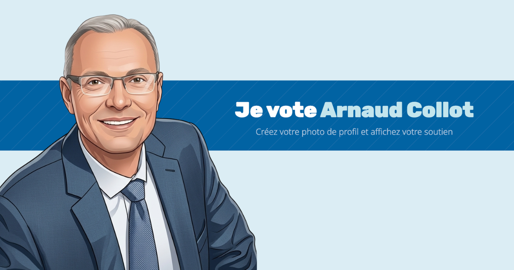

# Générateur de photo de profil « Je vote Arnaud Collot » : Municipales 2026 à Épinay-sur-Orge



Outil web de soutien créé pendant la campagne des élections municipales de mars 2026 à Épinay-sur-Orge (Essonne), pour la liste **LIPE (Libres et Indépendants pour Épinay)** menée par Arnaud Collot.

Chacun pouvait importer sa photo, lui ajouter un bandeau circulaire « Je vote Arnaud Collot » et la télécharger pour l'utiliser comme photo de profil sur Facebook, Instagram, WhatsApp ou LinkedIn.

> Projet archivé : la campagne est terminée. Ce dépôt conserve le code tel qu'il a été mis en ligne sur `soutien.arnaudcollot.com`.

## Fonctionnalités

- **Import de la photo** par clic ou glisser-déposer (JPG, PNG, WEBP), recadrée automatiquement en cercle.
- **Deux messages au choix** : « Je vote Arnaud Collot » ou « Je soutiens Arnaud Collot ».
- **Bandeau personnalisable** : 4 couleurs de fond aux couleurs de la campagne et épaisseur réglable.
- **Texte courbé** qui suit l'arc du bandeau, dessiné lettre par lettre sur un canvas.
- **Aperçu en temps réel** et export PNG 600 × 600 px.
- **Confidentialité** : tout le traitement se fait dans le navigateur, aucune photo n'est envoyée à un serveur.
- Balises Open Graph et Twitter Card pour le partage sur les réseaux sociaux.

## Stack technique

Un seul fichier `index.html` autonome : HTML, CSS et JavaScript natifs (API Canvas 2D), sans framework ni étape de build. Seule dépendance externe : Google Fonts (Rubik, Noto Sans).

## Structure

```
.
├── index.html     # Générateur complet (interface, styles, rendu canvas)
├── og-image.png   # Image de partage réseaux sociaux (1200×630)
└── README.md
```

## Lancer en local

Ouvrir `index.html` dans un navigateur, ou servir le dossier :

```bash
python3 -m http.server 8000
# puis http://localhost:8000
```

## Réutilisation

Pour une autre campagne ou un autre événement, il suffit de modifier dans `index.html` les messages proposés, les couleurs (`data-color` et variables CSS dans `:root`), le nom du fichier téléchargé et les balises Open Graph.

## Crédits

Conception et développement : Sébastien Piconnier
